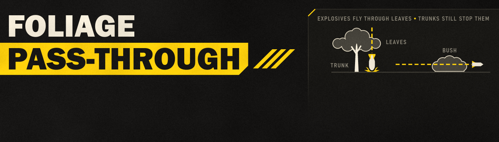

# Foliage Pass-Through v1.0

Rockets, missiles, launcher rounds and stratagem ordnance no longer explode in tree canopies and bushes. A 500kg bomb
that falls through a treetop reaches the ground; a rocket fired through a bush keeps going. Trunks, limbs, the
ground, rocks, buildings and enemies still stop them.

**Status:** pre-release. The change itself is verified in the game: all 99 projectile types use the new collision
check from the moment the game loads until it quits, and no other projectile type changes. How shots behave in a
forest in play is not tested yet. See [docs/TECHNICAL.md](docs/TECHNICAL.md).

## What changes

Every projectile in Helldivers 2 checks what is in its path with one of a few collision checks, and its settings say
which. The usual one stops at the leafy part of trees and bushes. Explosive projectiles then detonate there: in the
canopy, on a twig, in a bush. The game already has a second check that skips leaves and bushes, and it gives that one
to plasma bolts and lasers.

The mod gives the same check to the player-side projectiles that explode on impact: 99 types, among them every Eagle
bomb (500kg, 100kg, napalm, cluster, smoke), the orbital and SEAF artillery shells, the 75 mm HEAT rounds, rockets,
missiles, grenade-launcher rounds and cannon rounds. Their path ignores leaves and bushes, so they fly or fall
through and explode on what is behind: the ground, a rock, a building, an enemy, or a tree's trunk or limbs, which
use a different, solid surface. Enemy projectiles are unchanged, so bushes and trees still give you the same cover
against them. Bullets and other projectiles that do not explode are unchanged.

## Requirements and install

- Helldivers 2 Steam build **25480438** (EXE 1.8.46015.0). The mod checks the EXE and game.dll hashes and every
  projectile setting it changes, and does nothing on any other build.
- [Bingus Shared Loader v18 or newer](https://github.com/CowboyBingus/BingusSharedLoader/releases/latest).

Import the release ZIP into Arsenal or HD2MM together with the loader, enable and deploy both, then restart the
game. The log is `%LOCALAPPDATA%\CowboyBingus\Helldivers2\Logs\FoliagePassThrough.log`: one line when the change is
made and one at shutdown saying whether it held.

## Multiplayer

The change is in your own game's settings and sends nothing. Each player's game simulates the shots it sees, so
players without the mod may still see a shot burst in a canopy. Which player's game decides where a shot explodes
and deals its damage in a squad with mixed installs is not tested yet.

## Cost

- Once, when the game has loaded its projectile settings: one read of the settings index, one read per projectile
  type, one checked write of the 99 values and one read-back each. Unmeasured in game.
- Per frame: nothing. The mod keeps no update hook after the change (none at all when the settings are already
  loaded at startup, as in every test so far).
- At shutdown: one read per projectile type for the log line.

## Other mods

A mod that changes the same projectile settings (the collision check of these 99 types) conflicts: this mod refuses
the change when a value is not the one it expects and says so in its log.

## Build and test

Clone [Bingus Shared Loader](https://github.com/CowboyBingus/BingusSharedLoader) beside this repository (or set
`BINGUS_SHARED_LOADER` to its path). The tests need LuaJIT (`HD2_LUAJIT`, or `luajit` on `PATH`) and the installed
game's `bin/lua51.dll` (set `HD2_LUA51_DLL` if the game is not in the default Steam folder).

```
python scripts/build.py
```

It runs the tests in LuaJIT and in the game's own `lua51.dll` (the game is never started), checks that the
vendored [Bingus Shared Runtime](https://github.com/CowboyBingus/BingusSharedRuntime) files are byte-identical to
the canonical ones when the workspace has them, and writes `releases/Foliage-Pass-Through-v1.0.zip`.

## License

Zero-Clause BSD (0BSD), see `LICENSE`.

**AI disclosure:** Claude Opus 5.5 assisted with research, implementation, tests, documentation and artwork.
